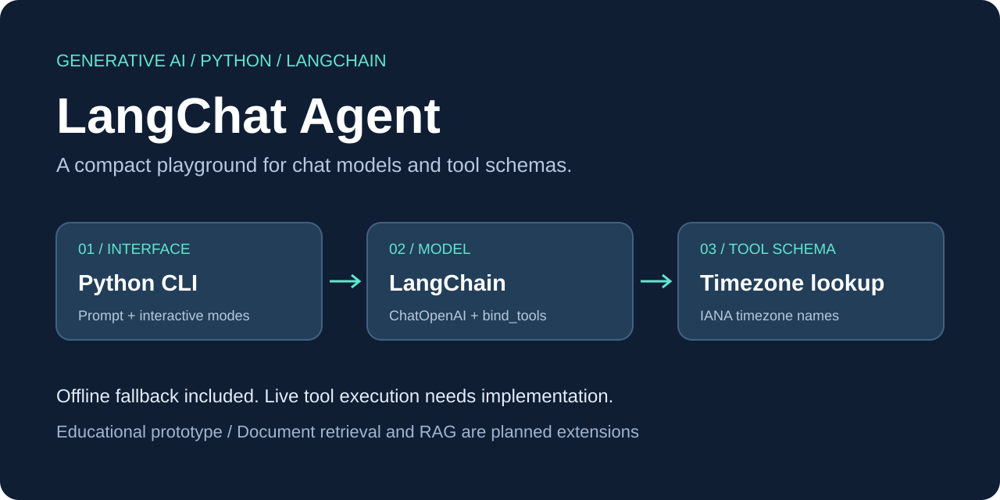
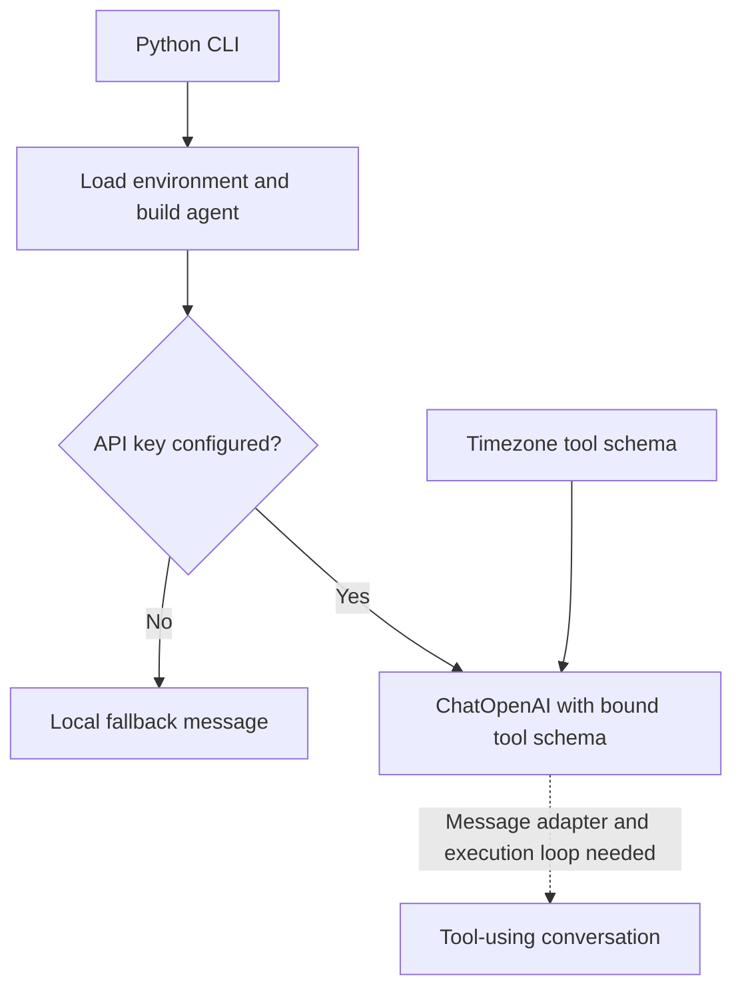

# GenAI · LangChat Agent

**A compact Python playground for LangChain chat models, tool schemas, and command-line conversations.**



LangChat explores the building blocks of a generative AI assistant: a chat model, a timezone lookup tool, single-prompt and interactive CLI modes, and an offline fallback. Its small codebase is intended for learning and experimentation.

> **Status:** Educational prototype. The offline fallback works without an API key. The live model path needs message adaptation and a tool execution loop. Document retrieval and RAG are planned extensions, not implemented features.

## Project name

`GenAI-LangChat-Agent` follows **Project Type – Project Name**. GenAI describes the generative chat model, LangChat preserves the project identity, and Agent describes the intended tool-using direction. This project does not train an ML/DL model. RAGBot would imply a retrieval pipeline that is not present in this source.

## Features and implementation

| Component | Current behavior |
| --- | --- |
| Model configuration | ChatOpenAI with temperature zero and a configurable model name |
| Tool schema | `get_time_in_timezone` returns formatted time for an IANA timezone |
| Tool binding | `llm.bind_tools` advertises the timezone tool to the model |
| Offline fallback | Fixed setup message when `OPENAI_API_KEY` is absent |
| Single prompt | CLI `--prompt` argument |
| Interactive CLI | In-memory conversation tuples; `exit` or `quit` ends the session |
| Logging | Loguru events; optional rotating-file configuration helper |
| Tests | One factory-construction smoke test |

## Architecture



`build_agent()` returns either a local fallback accepting an input dictionary or a LangChain model runnable. Those paths do not yet share a compatible input/output interface. A prompt template is constructed but is not connected to the runnable. Tool binding supplies a schema; it does not execute the Python tool or return its result to the model.

## Technology

Python 3.10+, LangChain, langchain-openai, python-dotenv, Loguru, Python zoneinfo, and pytest. Runtime requirements are in `requirements.txt`; test requirements are in `test_requirements.txt`. The original `pyproject.toml` has an empty dependencies list, so install using the requirements files.

## Setup

```powershell
git clone https://github.com/vams2krish/GenAI-LangChat-Agent.git
cd GenAI-LangChat-Agent
python -m venv .venv
.\.venv\Scripts\Activate.ps1
python -m pip install -r requirements.txt -r test_requirements.txt
Copy-Item .env.example .env
```

On macOS/Linux, activate with `source .venv/bin/activate` and copy with `cp .env.example .env`.

Leave `OPENAI_API_KEY` empty for the offline demo. To develop the live path, configure your own key privately in `.env`. Never commit credentials. Configuring a key does not resolve the incomplete live execution path described below.

## Usage

Run from the repository root after installing dependencies.

### Offline single-prompt demo

With no key configured:

```powershell
python src/agent_cli.py --prompt "What time is it in UTC?"
```

Expected response:

```text
(LLM disabled: set OPENAI_API_KEY to enable the agent.)
```

The fallback does not answer questions or execute tools.

### Interactive mode

```powershell
python src/agent_cli.py --interactive
```

Enter text at `You>`. Type `exit` or `quit` to end. Conversation history lasts only for the process. The live runnable needs interface repairs before it can consume that history correctly.

### Model selection argument

```powershell
python src/agent_cli.py --prompt "Hello" --model YOUR_MODEL_NAME
```

The CLI source defaults to `gpt-4o-mini`; the factory defaults to `gpt-3.5-turbo`. These are source defaults, not model availability guarantees.

### Direct timezone tool

```powershell
python -c "from src.agent import get_time_in_timezone; print(get_time_in_timezone.invoke({'timezone': 'UTC'}))"
```

Examples: `UTC`, `America/New_York`, `Asia/Kolkata`. Accessible IANA timezone data is required. If the operating system lacks it, install the optional `tzdata` package. Invalid names currently raise an exception.

## Tests

```powershell
python -m pytest -q
```

The included test checks factory construction only. It does not validate model output, tool execution, retrieval, or deployment readiness. No API request is needed when the key is absent.

## Project structure

```text
GenAI-LangChat-Agent/
  README.md
  docs/project-overview.svg
  .env.example
  .gitignore
  pyproject.toml
  requirements.txt
  test_requirements.txt
  conftest.py
  src/
    agent.py
    agent_cli.py
    logging_config.py
    tests/test_agent.py
```

## Logging and local data

The CLI logs prompt text through Loguru. Avoid sensitive prompts if logs may be collected. `configure_logging()` defines rotating `agent.log` files and console output, but is not currently called by the CLI. Local environments, caches, credentials, logs, and build artifacts are excluded through `.gitignore`.

## Known limitations

- The CLI passes an `input`/`chat_history` dictionary and expects a dictionary response; the live model runnable needs message input and returns a different response type.
- Tool calls are not dispatched and results are not sent back to the model.
- The prompt template and scratchpad are not wired into execution.
- There is no document ingestion, chunking, embedding model, vector store, retrieval, or citation support.
- There is no web UI, persistent history, authentication, or deployment configuration.
- Dependencies have lower bounds rather than a lock file.
- Error handling, bounded execution, retries, timeouts, and end-to-end tests need development.

## Roadmap toward a RAG bot

1. Normalize executor inputs/outputs and connect the prompt template.
2. Add a bounded model/tool execution loop with tool-result messages.
3. Test execution with fake model responses and explicit offline configuration.
4. Implement document loading, chunking, embeddings, and a vector store.
5. Retrieve relevant chunks and generate answers with document citations.
6. Evaluate retrieval quality and add persistence and deployment controls.

## Contributions and licensing

Focused fixes, tests, and documentation improvements are welcome through issues and pull requests. Keep examples free of private documents and credentials. No license has been selected; public visibility alone does not grant an open-source license.
